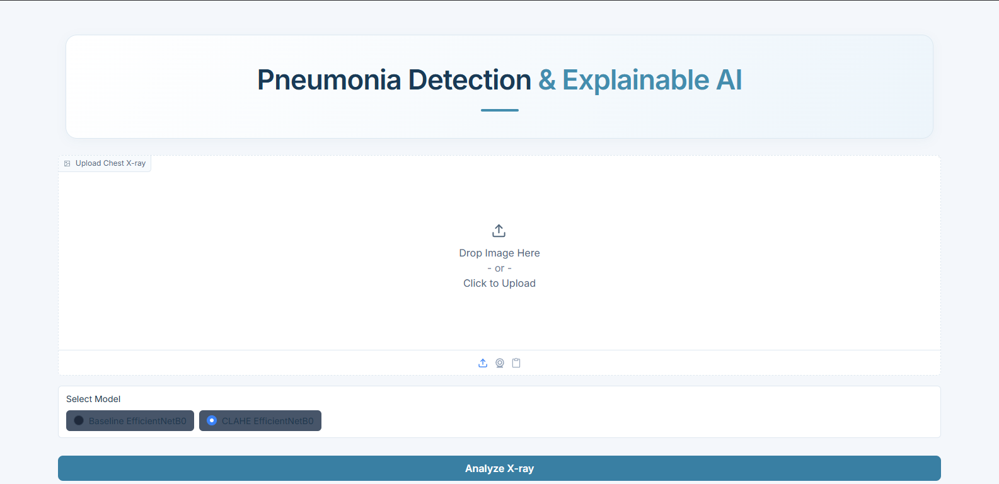
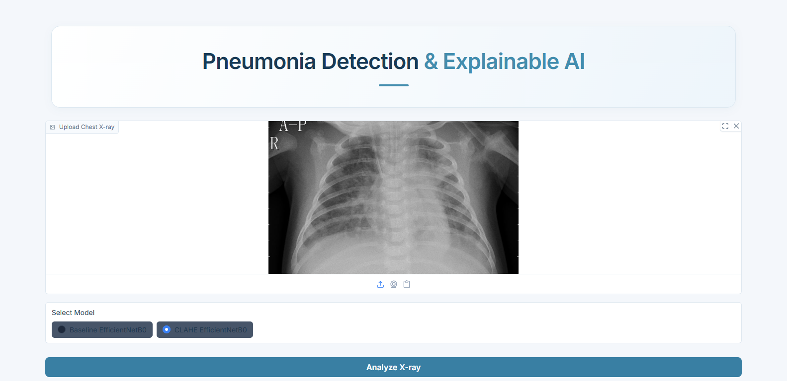
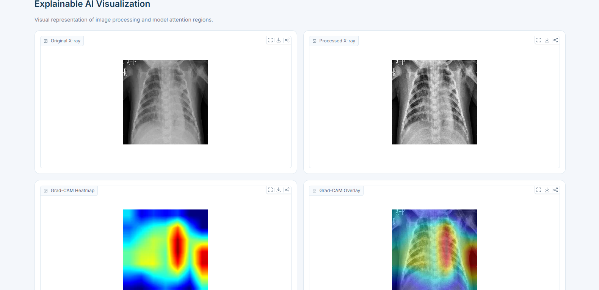

# 🫁 Pneumonia Detection using Explainable AI


An AI-powered chest X-ray analysis system that detects pneumonia using **EfficientNetB0** and explains its predictions through **Grad-CAM (Gradient-weighted Class Activation Mapping)**.

The project applies **CLAHE (Contrast Limited Adaptive Histogram Equalization)** preprocessing and lets you compare two trained models: **Baseline EfficientNetB0** and **CLAHE EfficientNetB0**.

> ⚠️ **This is an academic research project and is not intended for clinical diagnosis.**

---

## 📑 Table of Contents

- [Overview](#-overview)
- [Key Features](#-key-features)
- [Screenshots](#️-screenshots)
- [Dataset](#-dataset)
- [Models and Methodology](#-models-and-methodology)
- [Training Configuration](#️-training-configuration)
- [Results](#-results)
- [Tech Stack](#️-tech-stack)
- [Project Structure](#-project-structure)
- [Installation and Setup](#️-installation-and-setup)
- [Usage](#-usage)
- [Limitations](#-limitations)
- [Future Enhancements](#-future-enhancements)
- [Disclaimer](#️-disclaimer)
- [Author](#-author)

---

## 🚀 Overview

Pneumonia is a respiratory infection that causes inflammation in the lungs. This project explores deep learning and Explainable AI (XAI) to classify chest X-ray images as **NORMAL** or **PNEUMONIA** and to visualize the regions that influence each prediction.

Users can upload a chest X-ray, choose a trained model, get a prediction, and inspect Grad-CAM explanations, all through an interactive Gradio interface.

## ✨ Key Features

- **Pneumonia Detection:** Binary classification (Normal vs Pneumonia) using trained EfficientNetB0 models.
- **Dual Model Comparison:** Switch between Baseline and CLAHE-trained EfficientNetB0.
- **CLAHE Preprocessing:** Enhances local contrast to improve image visibility.
- **Grad-CAM Explainability:** Highlights the regions contributing to each prediction.
- **Rich Visualization:** Shows the original X-ray, processed X-ray, Grad-CAM heatmap, and Grad-CAM overlay.
- **Interactive UI:** Simple upload-and-analyze workflow built with Gradio.

## 🖼️ Screenshots

### Home Page


### Image Upload and Model Selection


### Explainable AI Visualization
Original X-ray, processed X-ray, Grad-CAM heatmap, and Grad-CAM overlay.



## 📦 Dataset

| Detail | Value |
|---|---|
| Dataset | Chest X-Ray Images (Pneumonia) |
| Source | [Kaggle: Chest X-Ray Images (Pneumonia)](https://www.kaggle.com/datasets/paultimothymooney/chest-xray-pneumonia), Kermany et al. |
| Classes | NORMAL, PNEUMONIA |
| Original training set | 5,216 images |
| Original validation set | 16 images |
| Test set | 624 images |

The original training and validation folders were **combined and re-split using a stratified split**. The original test set was kept separate.

| Split | Total | Normal | Pneumonia |
|---|---|---|---|
| Training | 4,433 | 1,140 | 3,293 |
| Validation | 783 | 201 | 582 |
| Testing | 624 | 234 | 390 |
| **Total** | **5,840** | **1,575** | **4,265** |

## 🧠 Models and Methodology

| Model | Description |
|---|---|
| Baseline EfficientNetB0 | Trained using the baseline preprocessing pipeline |
| CLAHE EfficientNetB0 | Trained using CLAHE-enhanced images |

### Image Processing Pipeline

1. Upload a chest X-ray image.
2. Preprocess the image.
3. Apply the selected model's preprocessing pipeline.
4. Generate a pneumonia prediction (threshold = 0.5).
5. Generate Grad-CAM activation maps.
6. Display the prediction and explainability visualizations.

### Why Grad-CAM?

Grad-CAM produces heatmaps that highlight the image regions most associated with the model's output. Instead of only returning a label, the app shows *where* the model was looking, giving an additional perspective on model behaviour.

## ⚙️ Training Configuration

| Parameter | Value |
|---|---|
| Architecture | EfficientNetB0 |
| Transfer learning | ImageNet pretrained weights |
| Input image size | 224 × 224 |
| Epochs | 3 |
| Batch size | 32 |
| Optimizer | Adam |
| Learning rate | 0.001 |
| Backbone | Frozen during training |
| Loss function | Binary Crossentropy |
| Class weighting | Yes |
| Prediction threshold | 0.5 |

**Class weights:**

| Class | Weight |
|---|---|
| Normal | 1.9443 |
| Pneumonia | 0.6731 |

## 📈 Results

Evaluated on the held-out test set (624 images: 234 Normal, 390 Pneumonia).

| Metric | Baseline EfficientNetB0 | CLAHE EfficientNetB0 |
|---|---|---|
| Accuracy | 81.25% | 81.73% |
| Precision | 78.98% | 79.87% |
| Recall (Sensitivity) | 95.38% | 94.62% |
| F1-score | 86.41% | 86.62% |
| ROC-AUC | 93.27% | 93.28% |

### Confusion Matrices

**Baseline EfficientNetB0**

| | Predicted Normal | Predicted Pneumonia |
|---|---|---|
| **Actual Normal** | 135 | 99 |
| **Actual Pneumonia** | 18 | 372 |

**CLAHE EfficientNetB0**

| | Predicted Normal | Predicted Pneumonia |
|---|---|---|
| **Actual Normal** | 141 | 93 |
| **Actual Pneumonia** | 21 | 369 |

### Observations

- Both models achieve high recall (above 94%), so they miss few pneumonia cases.
- Specificity is much lower (about 57.7% for Baseline and 60.3% for CLAHE), so many normal X-rays are flagged as pneumonia.
- CLAHE gives a small improvement in accuracy, precision, F1-score, and specificity, with a slightly lower recall. The ROC-AUC is nearly identical for both models.

## 🛠️ Tech Stack

| Category | Technologies |
|---|---|
| Language | Python |
| Deep Learning | TensorFlow, Keras |
| Model Architecture | EfficientNetB0 |
| Image Processing | OpenCV, NumPy |
| Explainable AI | Grad-CAM |
| Interface | Gradio |
| Version Control | Git, GitHub |

## 📂 Project Structure

```text
pneumonia-detection-xai/
│
├── models/
│   ├── efficientnetb0_baseline.keras
│   └── efficientnetb0_clahe.keras
│
├── screenshots/
│   ├── homepage.png
│   ├── prediction-result.png
│   └── gradcam-visualization.png
│
├── src/
│   ├── __init__.py
│   ├── model_loader.py      # Loads the selected model
│   ├── preprocessing.py     # Baseline and CLAHE preprocessing
│   ├── prediction.py        # Runs inference
│   ├── gradcam.py           # Grad-CAM heatmap generation
│   └── visualization.py     # Heatmap overlay and display helpers
│
├── app.py                   # Gradio application entry point
├── requirements.txt
├── .gitignore
└── README.md
```

The trained models are included in the repository under `models/`, so no separate download is needed.

## ⚙️ Installation and Setup

**Prerequisites:** Python and `git`.

```bash
# 1. Clone the repository
git clone https://github.com/Gagan0014/Pneumonia-Detection-Xai.git
cd Pneumonia-Detection-Xai

# 2. Create a virtual environment
python -m venv venv

# 3. Activate it
venv\Scripts\activate          # Windows
source venv/bin/activate       # Linux / macOS

# 4. Install dependencies
pip install -r requirements.txt

# 5. Run the app
python app.py
```

Gradio will print a local URL in the terminal. Open it in your browser.

## 📊 Usage

1. Upload a chest X-ray image.
2. Select **Baseline EfficientNetB0** or **CLAHE EfficientNetB0**.
3. Click **Analyze X-ray**.
4. View the prediction.
5. Compare the original and processed images.
6. Explore the Grad-CAM heatmap and overlay to understand model attention.

## 🚧 Limitations

- Models were trained for only 3 epochs with a frozen backbone, so there is room for improvement.
- Specificity is relatively low, which means false positives on normal X-rays are common.
- Trained on a single public dataset, so performance may not generalize to other hospitals, scanners, or populations.
- Grad-CAM highlights are an interpretability aid, not proof of clinical reasoning.
- Not validated by medical professionals.

## 🔮 Future Enhancements

- [ ] Fine-tune the EfficientNetB0 backbone and train for more epochs
- [ ] Improve specificity and reduce false positives
- [ ] Model performance comparison and evaluation dashboard
- [ ] Additional explainability techniques such as LIME
- [ ] Improved model generalization
- [ ] Prediction history and report generation
- [ ] Cloud deployment and a permanent public web interface

## ⚠️ Disclaimer

This project is developed for academic, educational, and research purposes only. It is **not** a medical diagnostic tool and must not be used as a substitute for professional medical advice, diagnosis, or treatment.

## 👨‍💻 Author

**Gagan Pathak**
B.Tech Computer Engineering, Jamia Millia Islamia
GitHub: [@Gagan0014](https://github.com/Gagan0014)

---

⭐ If you find this project interesting, consider giving the repository a star!
